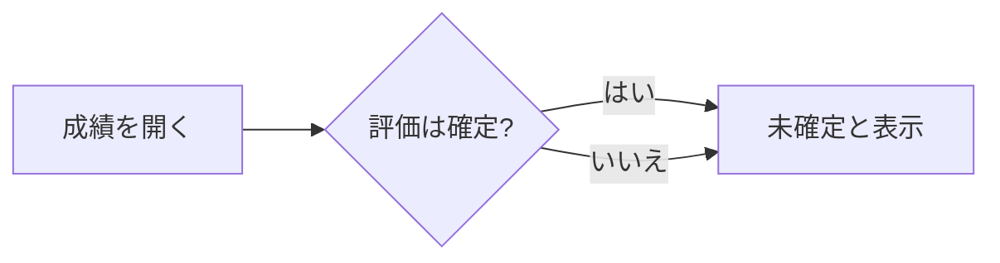
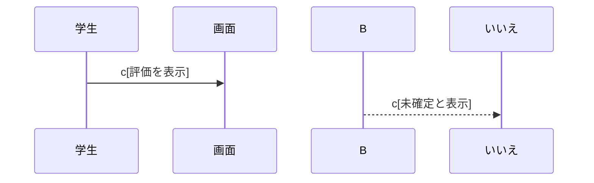

# システム設計I
## 次の見出し

- 要件定義
  - 外部設計

## 太字と斜体
この授業は **ここ** が*重要*です

## 引用とリンク
>ここのサイトから調べました（引用）

[いわきコンカレ](https://www.iwaki-cc.ac.jp/)(リンク)

## 表（---:は右揃え　:---:は中央揃え）
|項目名|型|桁数|必須|
|---|---|---:|:---:|
|学籍番号|文字|5|〇|
|科目名|文字|60|〇|
|素点|数値|3|〇|

## コードブロック（バッククォート3つで囲む）
```
|項目名|型|桁数|必須|
|---|---|---:|:---:|
|学籍番号|文字|5|〇|
|科目名|文字|60|〇|
|素点|数値|3|〇|
```
## チェックリストと画像
- [x] 機能一覧を作る
- [ ] 日機能要件を書く
- [ ] レビューを受ける


## マーメイド　図形　コードブロック　LR TD(トップダウン)

## シーケンス図　図形　コードブロック　->>(依頼) -->>(応答)

